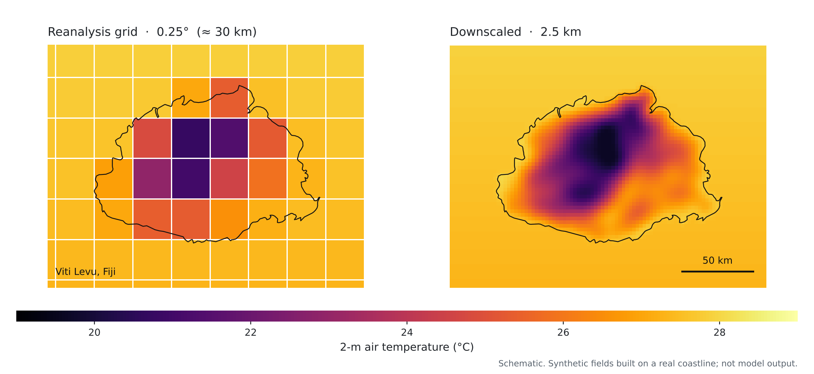
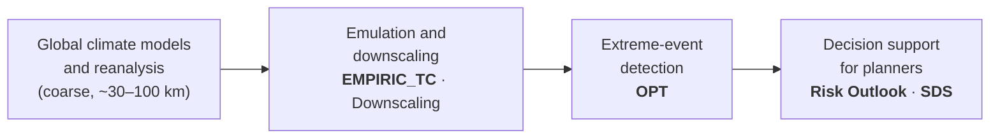

# EMPIRIC

### High-resolution, high-quality weather and climate predictions for small islands and coastal regions

<picture>
  <source media="(prefers-color-scheme: dark)" srcset="https://raw.githubusercontent.com/EMPIRIC2/.github/main/profile/figures/downscaling_schematic_dark.png">
  
</picture>

The resolution gap EMPIRIC works on. Left: a 0.25° reanalysis grid, the input available everywhere. Right: the 2.5 km island scale our downscaling targets. Schematic with synthetic fields on a real coastline, not model output.

Global climate models run on grids of 50 to 100 km. Most Pacific islands are smaller than a single grid cell, so they are missing from the models that are supposed to describe their future. EMPIRIC builds open, machine-learning-based tools that fill that gap: fast emulators of tropical cyclone hazard, statistically sound definitions of extreme events, and web interfaces that put the results in the hands of the people who plan for them. Our focus is Pacific Island Countries and Territories (PICTs), and the health systems and infrastructure that have to withstand what comes.

---

## How the pieces fit together

1. **Start from what exists.** Global models and reanalysis products are the only long-record, physically consistent picture of the climate, but their resolution is far too coarse for an island.
2. **Bring it to island scale.** A neural-network emulator reproduces the output of an expensive cyclone model in seconds, and downscaling methods map coarse fields onto fine grids.
3. **Define "extreme" rigorously.** The Optimal Path Threshold method sets event thresholds objectively, including for compound events and shifting baselines.
4. **Deliver it where decisions are made.** Interactive maps and outlooks show hazard and uncertainty next to the facilities that matter.

---

## Tools

Status labels are meant literally. **Published** means peer-reviewed and released. **Stable** means the code runs as documented. **Prototype** means it works but is still changing. **In development** means there is no public release yet.

| Tool | What it does | Status |
|---|---|---|
| **[EMPIRIC_TC](https://github.com/EMPIRIC2/EMPIRIC_TC)** | A Fourier Neural Operator (a neural network that learns mappings between spatial fields) trained to emulate the STORM statistical-dynamical tropical cyclone model. Given a map of where storms form, it returns ensemble-mean cyclone hazard for the South Pacific at 0.5° resolution in seconds instead of hours. Trained models and test data are attached to each release. | **Published** · v1.2 · [Zenodo](https://zenodo.org/records/16876981) · MIT |
| **[OPT_method](https://github.com/EMPIRIC2/OPT_method)** | Reference implementation of the Optimal Path Threshold (OPT) method, a dynamic-programming approach that finds the thresholds defining an extreme event at a chosen severity level. Works for single variables and for compound events in two or three dimensions. Requires only Python and NumPy. | **Stable** · MIT |
| **[Rhode Island Weather Risk Outlook](https://github.com/EMPIRIC2/opt-ui-forecast)** | A four-week outlook of the chance of an extreme day, by county and event type (hot, cold, wet, windy, and compound combinations), built by applying OPT thresholds to subseasonal-to-seasonal forecast ensembles. A test bed for the method on a region with dense observations before it is applied to the Pacific. [Live page](https://empiric2.github.io/opt-ui-forecast/). | **Prototype** · not an official warning product |
| **Spatial Decision Support (SDS)** | A browser-based GIS platform that shows site-specific cyclone hazard and its uncertainty alongside health-facility locations. [Pre-alpha demo](https://empiric-tc-model.web.app/). | **Prototype** · pre-alpha |
| **Downscaling** | Transfer-learning methods for mapping coarse reanalysis (about 30 km) to island-scale meteorological fields (about 2.5 km) with very little local training data. | **In development** · no public code yet |

### Also hosted in this organization

- **[TAC-to-IWXXM](https://github.com/EMPIRIC2/TAC-to-IWXXM)** converts aviation weather messages (METAR, SPECI, TAF, SIGMET) from traditional alphanumeric code to the WMO IWXXM XML standard, with schema validation. A production service runs at [app.tac-to-iwxxm.com](https://app.tac-to-iwxxm.com).

---

## Who this is for

- **Meteorological services and disaster-management offices** in PICTs that need hazard projections for their own islands, not for the ocean grid cell around them.
- **Health-system planners** deciding where to site, harden, or relocate facilities.
- **Researchers** who need a fast cyclone-hazard emulator, or an objective way to define extreme and compound events in a non-stationary climate.

Everything here is open source under the MIT license. Issues and pull requests are welcome on any repository.

---

## Publications

**Winkelman E., McCrystall M., Forbes C., Dresdner G., Kafoa B., Natuzzi E., Taylor S., McLeod E., Horvat C.** (2026). *EMPIRIC_TC: A site-specific AI-based emulator for tropical cyclone hazards using Fourier Neural Operators.* Journal of Advances in Modeling Earth Systems. [doi:10.1029/2025MS004998](https://doi.org/10.1029/2025MS004998)

**Zhao B., Horvat C., Gao H.** (2025). *An optimal path threshold method for rigorously identifying extreme climate events.* Environmental Research Letters, 20(2), 024048. [doi:10.1088/1748-9326/adae24](https://doi.org/10.1088/1748-9326/adae24)

If you use these tools in published work, please cite the corresponding paper and, for EMPIRIC_TC, the Zenodo release you used.

---

## Support

This work is made possible by:

- **Climate Change AI**, 2023 Innovation Grant: *EMPIRIC_AI: AI-enabled Ensemble Projections of Cyclone Risk for Health Infrastructure in Pacific Island Countries and Territories*
- **U.S. National Science Foundation**, RISE 2528950: *C2H2 EAGER: Site-specific Climate Risks to South Pacific Health and Health Infrastructure*

---

## Contact

**Dr. Christopher Horvat**
Department of Earth, Environmental & Planetary Sciences, Brown University
[chhorvat@brown.edu](mailto:chhorvat@brown.edu)

Questions, suggestions, and collaboration requests are welcome.
