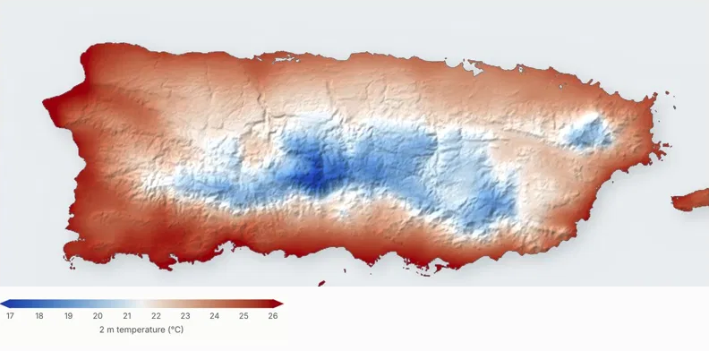

# EMPIRIC

### High-resolution, high-quality weather and climate predictions for small islands and coastal regions

2 m air temperature over Puerto Rico at 2.5 km, downscaled by EMPIRIC.

While weather-related losses and exposure are concentrated in island regions and along coastlines, these areas are often missing or poorly resolved in weather and climate models, whose grid resolutions are 25 km or coarser. EMPIRIC's mission is to provide cutting-edge, high-quality data for these regions using a suite of tools developed, or in active development, by our team, to enable decision-makers in small island states and coastal areas to make meaningful, informed, stakeholder-driven decisions.

---

## Tools

EMPIRIC centers on the development of several tools:

1. **EMPIRIC_DS: kilometre-scale downscaling.** Generative transfer learning that maps coarse meteorological fields to kilometre scale, on timescales of hours to centuries. In development.

2. **[EMPIRIC_TC](https://github.com/EMPIRIC2/EMPIRIC_TC): tropical cyclone prediction.** A Fourier Neural Operator emulator of the STORM tropical cyclone model. Produces site-specific cyclone hazard for the South Pacific in seconds. Winkelman et al. (2026); code and trained models at [v1.2 on Zenodo](https://zenodo.org/records/16876981).

3. **[OPT](https://github.com/EMPIRIC2/OPT_method): optimal extreme statistics.** The Optimal Path Threshold method determines the optimal characterization of extremes, with applications in human health, sea ice loss, evaporation, and agriculture. Zhao, Horvat, and Gao (2025).

4. **EMPIRIC_SDS: spatial decision support.** A web GIS platform showing site-specific hazard and uncertainty alongside health-facility data. [Pre-alpha demo](https://empiric-tc-model.web.app/).

5. **[Risk outlooks for coastal regions](https://github.com/EMPIRIC2/opt-ui-forecast).** Four-week outlooks of the chance of an extreme weather day, by county and event type, from OPT thresholds applied to subseasonal-to-seasonal forecast ensembles. [Rhode Island prototype](https://empiric2.github.io/opt-ui-forecast/).

6. **[TAC-to-IWXXM](https://github.com/EMPIRIC2/TAC-to-IWXXM): future-proofing meteorological data.** Converts aviation weather messages (METAR, SPECI, TAF, SIGMET) from traditional alphanumeric code to the WMO IWXXM standard, with validation. In production at [app.tac-to-iwxxm.com](https://app.tac-to-iwxxm.com).

---

## Recent publications

**Winkelman E., McCrystall M., Forbes C., Dresdner G., Kafoa B., Natuzzi E., Taylor S., McLeod E., Horvat C.** (2026). *EMPIRIC_TC: A site-specific AI-based emulator for tropical cyclone hazards using Fourier Neural Operators.* Journal of Advances in Modeling Earth Systems. [doi:10.1029/2025MS004998](https://doi.org/10.1029/2025MS004998)

**Zhao B., Horvat C., Gao H.** (2025). *An optimal path threshold method for rigorously identifying extreme climate events.* Environmental Research Letters, 20(2), 024048. [doi:10.1088/1748-9326/adae24](https://doi.org/10.1088/1748-9326/adae24)

**Zhao B., Horvat C., Pearson C., Shah D., Gao H.** (2025). *Regional variations in drivers of extreme reference evapotranspiration across the contiguous United States.* Water Resources Research, 61(10), e2025WR040177. [doi:10.1029/2025WR040177](https://doi.org/10.1029/2025WR040177)

**Şalap-Ayça S., Mannino A., Horvat C., et al.** (2026). *Geospatial data in loss and damage in Pacific Small Island Developing States: insights, gaps and opportunities.* In *Research Symposium on Loss and Damage in Pacific Small Island Developing States: Proceedings of PSIDS 2025.* Springer Nature.

If you use these tools, please cite the corresponding paper.

---

## Support

EMPIRIC is supported by:

- **Climate Change AI**, 2023 Innovation Grant: *EMPIRIC_AI: AI-enabled Ensemble Projections of Cyclone Risk for Health Infrastructure in Pacific Island Countries and Territories*
- **U.S. National Science Foundation**, RISE 2528950: *C2H2 EAGER: Site-specific Climate Risks to South Pacific Health and Health Infrastructure*
- **CHAIRS-C, Brown University School of Public Health**, Pilot Grant: *Robust Associations between Multi-Type Compound Extreme Events and Older Adult Health*
- **Brown University Office of Sustainability & Resiliency**, 2025 Sustainability Seed Grant: *Tracking and Forecasting Health Impacts of Compound Extreme Climate Impacts in the Providence Area*

---

## Contact

**Prof. Christopher Horvat**
Department of Earth, Environmental & Planetary Sciences, Brown University
[chhorvat@brown.edu](mailto:chhorvat@brown.edu)

Questions and collaborations welcome.
